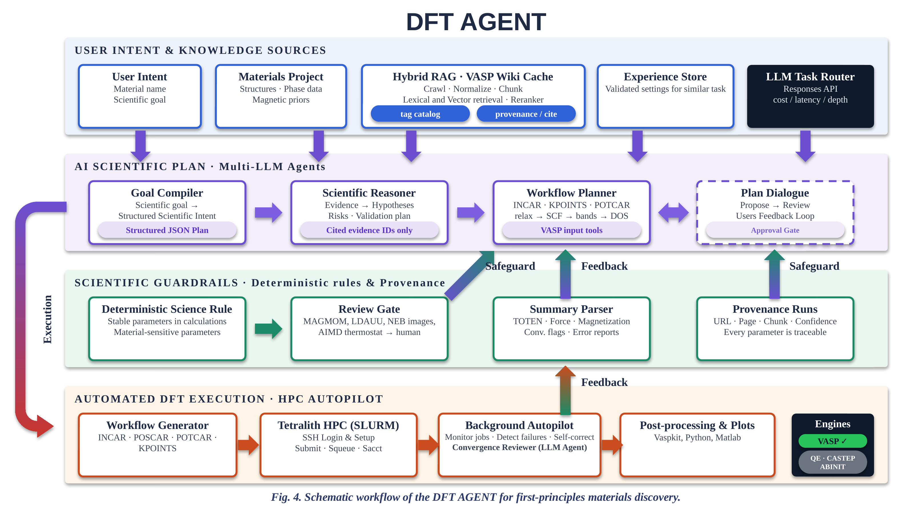

# DFT Agent


Version `0.4.6`. [中文说明](README.zh-CN.md)

[Qirui Cui](https://www.kth.se/profile/qiruic?l=en) · KTH Royal Institute of Technology; [Anna Delin](https://www.kth.se/profile/annadel) · KTH Royal Institute of Technology

Describe a calculation, review its inputs, and run VASP, Quantum ESPRESSO, ABINIT, CP2K or Elk on your own HPC cluster. Each project keeps its files, conversations and results together. You can revise tasks in chat, combine engines in a workflow, and discuss the results when they return.



Conceptual overview. Current engines: VASP, Quantum ESPRESSO, ABINIT, CP2K and Elk (the last three from 0.4.5).

The built-in workflows cover structure edits, relaxation, SCF, bands, DOS, magnetism, SOC, DFT+U and hybrid functionals. Available methods depend on the engine. [QE](docs/qe.md) also supports installation, phonons, NEB, electron–phonon coupling and conventional superconductivity. [ABINIT, CP2K and Elk](docs/open-source-codes.md) install from the app on supported Linux clusters: ABINIT adds phonons, CP2K large-cell calculations and molecular dynamics, and Elk optics and real-time TDDFT.


## Install

Download [v0.4.6](https://github.com/cuiqirui99/DFT-AGENT/releases/tag/v0.4.6):

- **Apple Silicon Mac, macOS 14+:** open the `.dmg`, copy **DFT Agent** to Applications, then open it.
- **Windows x64:** run the `.exe` installer, then open **DFT Agent** from the Start menu.

Python and model SDKs are included. Codex CLI and Claude Code CLI are optional; the app installs either one and starts its sign-in when you ask it to.

Or install from [PyPI](https://pypi.org/project/dft-agent/0.4.6/) with Python 3.11+:

```bash
python -m pip install "dft-agent[agent]==0.4.6"
dft-agent ui
```

[Source installation](docs/install.md#python-installation-from-source).

## Start a project

1. Click **New project** and give it a name.
2. Open **Connections → Model**. Follow the steps to install and sign in to **Codex CLI** or **Claude Code CLI**, or paste your provider's API key. **Test connection** checks a saved connection. [Model setup](docs/models.md).
3. Open **Cluster** and enter your SSH address, such as `ssh name@cluster`. The app tries your keys first, then asks for a password or login code when needed. Review the detected software, or add it under **Software**. If QE is missing, review and start its installation here. [Cluster setup](docs/install.md#your-first-cluster-setup).
4. Return to chat. Open **Files and runs → Files → Add files**, upload your structure, and click **Import files**. Describe what you want to calculate and refine the plan in the same conversation.
5. Click **Prepare inputs**, review the files and resources, tick the confirmation box, and click **Submit**. Follow the task in **Files and runs → Jobs** and open its outputs under **Results**.

The engine is selected per workflow step. A project can use one engine or several; it does not need a global switch. **Attach results** selects the runs for a follow-up discussion.

Model calls use your own account and quota. API keys and saved SSH passwords stay in the system keychain; login codes are not saved. VASP requires licensed VASP and POTCAR files. QE, ABINIT, CP2K and Elk are open source; the app installs them and their public libraries. No model credits or cluster allocation are included.

## Explore offline


Open **Settings → Legacy workbench → Runs → Load sample runs** to browse the bundled SrTiO3, Si, MgO and Fe results. The legacy workbench also retains manual input preparation, the original forms and Memory browser. Use **Settings → Language / 语言** to change the project interface language.

[Quickstart](docs/quickstart.md) · [Project guide](docs/project-workspace.md#use-the-workspace) · [Workflows](docs/workflows.md) · [Scientific guidance](docs/harness.md) · [Memory](docs/memory.md)

## Citation

Cui, Q. (2026). *DFT Agent* (v0.4.6). [Source](https://github.com/cuiqirui99/DFT-AGENT).

[Archived v0.4.4](https://doi.org/10.5281/zenodo.23476235).

[Install](docs/install.md) · [Windows](docs/windows.md) · [Methods](docs/methods.md) · [Input defaults](docs/input-defaults.md) · [CLI examples](docs/examples.md) · [VASP validation](docs/validation-0.4.1.md) · [QE validation](validation/qe-0.4.3/README.md) · [ABINIT, CP2K, Elk checks](docs/validation-0.4.5.md) · [MIT license](LICENSE) · [Notices](NOTICE.md) · [Citation](CITATION.cff)
