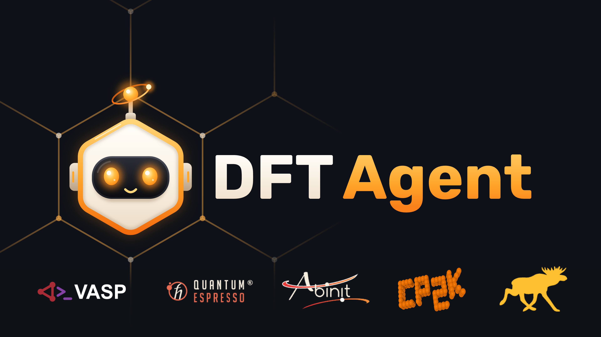

# DFT AGENT



**[Download v0.4.7](https://github.com/cuiqirui99/DFT-AGENT/releases/tag/v0.4.7)** · [macOS](https://github.com/cuiqirui99/DFT-AGENT/releases/download/v0.4.7/DFT-Agent-0.4.7-macOS-arm64.dmg) · [Windows](https://github.com/cuiqirui99/DFT-AGENT/releases/download/v0.4.7/DFT-Agent-0.4.7-Windows-x64.exe) · [Python](https://pypi.org/project/dft-agent/0.4.7/) · [Quickstart](docs/quickstart.md) · [中文](README.zh-CN.md)

[Qirui Cui](https://www.kth.se/profile/qiruic?l=en) · KTH Royal Institute of Technology; [Anna Delin](https://www.kth.se/profile/annadel) · KTH Royal Institute of Technology

Describe your calculation in chat. DFT Agent prepares the inputs and runs VASP, Quantum ESPRESSO, ABINIT, CP2K or Elk on your HPC cluster. Each project keeps its files, conversations and results together, so you can revise tasks and discuss the results in one place.


Workflows include structure editing, relaxation, SCF, bands, DOS, magnetism, SOC, DFT+U and hybrid functionals. [QE](docs/qe.md) also supports phonons, NEB, electron–phonon coupling and conventional superconductivity. [ABINIT, CP2K and Elk](docs/open-source-codes.md) add methods for phonons, molecular dynamics and optical response. Available methods depend on the engine.


## Install

Download [v0.4.7](https://github.com/cuiqirui99/DFT-AGENT/releases/tag/v0.4.7):

- **Apple Silicon Mac, macOS 14+:** open the `.dmg`, copy **DFT Agent** to Applications, then open it.
- **Windows x64:** run the `.exe` installer, then open **DFT Agent** from the Start menu.

Python and model SDKs are included. Codex CLI and Claude Code CLI are optional; the app installs either one and starts its sign-in when you ask it to.

Or install from [PyPI](https://pypi.org/project/dft-agent/0.4.7/) with Python 3.11+:

```bash
python -m pip install "dft-agent[agent]==0.4.7"
dft-agent ui
```

[Installation help](docs/install.md#desktop-app) · [Source installation](docs/install.md#python-installation-from-source).

## Start a project

Create a project with **New project**, then:

1. **Connect AI.** Open **Connections → Model**. Sign in to Codex CLI or Claude Code CLI, or enter an API key, then click **Connect**. [Account and token guide](docs/models.md).
2. **Connect your cluster.** In **Cluster**, enter your SSH address and follow the password or verification-code prompts. Select your installed software, or install an open-source engine on a supported cluster. [Cluster setup](docs/install.md#your-first-cluster-setup).
3. **Run a calculation.** Upload your structure under **Files and runs → Files** and click **Import files**. Describe the task in chat and refine the plan. Click **Prepare inputs**, review the files and resources, then confirm **Submit**.

Track jobs and download outputs in **Files and runs**. Use **Attach results** to discuss a run. Each workflow step can use a different engine.

Model calls use your own account and quota. You also need an HPC account; VASP requires licensed software and POTCAR files. [Requirements](docs/install.md#your-first-cluster-setup).

## Explore offline


Open **Settings → Classic workbench → Runs → Load sample runs** to explore the bundled SrTiO3, Si, MgO and Fe results without a cluster. Manual preparation and the Memory browser are also available there.

[Quickstart](docs/quickstart.md) · [Project guide](docs/project-workspace.md#use-the-workspace) · [Workflows](docs/workflows.md) · [Scientific guidance](docs/harness.md) · [Memory](docs/memory.md)

## Citation

Cui, Q. (2026). *DFT Agent* (v0.4.7). [Source](https://github.com/cuiqirui99/DFT-AGENT).

[Archived v0.4.7](https://doi.org/10.5281/zenodo.23664781).

[Install](docs/install.md) · [Windows](docs/windows.md) · [Methods](docs/methods.md) · [Input defaults](docs/input-defaults.md) · [CLI examples](docs/examples.md) · [VASP validation](docs/validation-0.4.1.md) · [QE validation](validation/qe-0.4.3/README.md) · [ABINIT, CP2K, Elk checks](docs/validation-0.4.5.md) · [MIT license](LICENSE) · [Notices](NOTICE.md) · [Citation](CITATION.cff)
