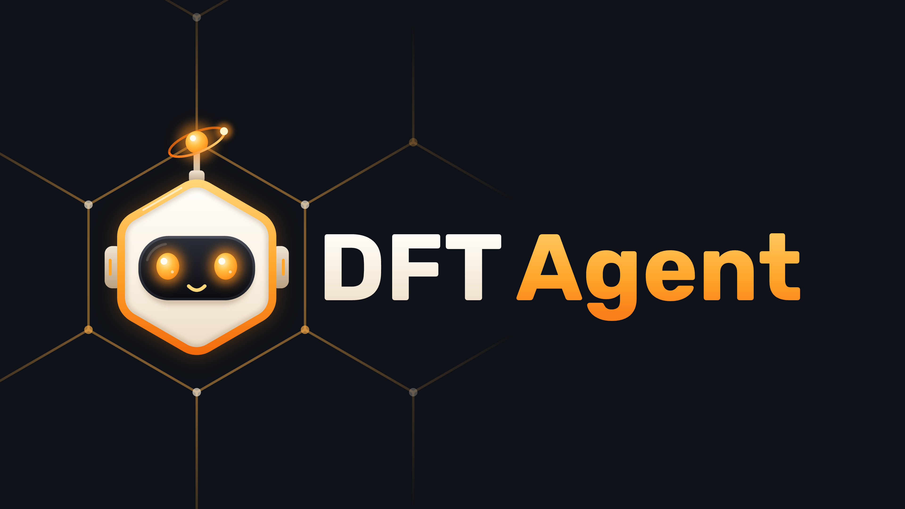

# DFT Agent

Version **0.4.9** · [Download for Mac](https://github.com/cuiqirui99/DFT-AGENT/releases/download/v0.4.9/DFT-Agent-0.4.9-macOS-arm64.dmg) · [Quickstart](docs/quickstart.md) · [中文](README.zh-CN.md)

Build a structure, describe a calculation, and work through the results in one conversation. DFT Agent connects your AI account to your own computing cluster. Each project keeps its structures, conversations, calculations and reports together.

VASP · Quantum ESPRESSO · ABINIT · CP2K · Elk · SIESTA

[Qirui Cui](https://www.kth.se/profile/qiruic?l=en), KTH Royal Institute of Technology. With contributions from [Anna Delin](https://www.kth.se/profile/annadel).

## Install

For **Apple Silicon Macs with macOS 14 or later**. Open the download, drag **DFT Agent** to Applications, and launch it. Python and the scientific libraries are included. [Installation help](docs/install.md).

This release is free to use for personal, academic and commercial work. It is distributed as an application; its application source tree is not published. Earlier releases remain available under their original licenses. [License](LICENSE) · [Previous versions](https://github.com/cuiqirui99/DFT-AGENT/releases).

## Use

1. **Connect your AI account.** Sign in with Codex CLI or Claude Code CLI, or enter an API key in **Connections → Model**. [Accounts and tokens](docs/models.md).
2. **Connect your cluster.** Enter its SSH address and follow the password or verification-code prompts. Review the detected software and computing resources. [Cluster setup](docs/install.md#your-first-cluster-setup).
3. **Add a structure.** Upload a CIF or POSCAR, search for a material, or describe what you want to build. Inspect and edit it before calculating. [Structure tools](docs/structures.md).
4. **Work in chat.** Plan calculations, change structures and parameters, and adjust resources. Review the prepared inputs and confirm submission.
5. **Explore the results.** Ask follow-up questions, make plots, download tables and reports, or prepare a continuation from a completed stage.

Model usage comes from your own account and quota. Computing uses your cluster allocation. VASP requires your licensed installation and potentials. Open-source engines can be installed through the app on compatible clusters.

## Calculations

Relaxation, electronic structure, magnetism, SOC, DFT+U and hybrid functionals are available through the supported engines. Methods vary by engine; the app checks each plan before submission.

- [Complex structures](docs/structures.md): interfaces, ribbons, layered and twisted structures, junctions and frameworks.
- [Defects](docs/defects.md): point defects, charge states and electronic levels.
- [Molecular dynamics](docs/molecular-dynamics.md): first-principles MD, selected LAMMPS potentials, trajectories and supported continuations.
- [Quantum ESPRESSO](docs/qe.md): phonons, NEB and [electron–phonon calculations](docs/qe-superconductivity.md).
- [SIESTA](docs/siesta.md) and [ABINIT, CP2K and Elk](docs/open-source-codes.md).

[Project guide](docs/project-workspace.md) · [Scientific guidance](docs/harness.md) · [Memory](docs/memory.md) · [Report an issue](https://github.com/cuiqirui99/DFT-AGENT/issues)

## Citation

Cui, Q. (2026). *DFT Agent* (Version 0.4.9). Zenodo. [doi:10.5281/zenodo.23867341](https://doi.org/10.5281/zenodo.23867341).

[Release notes](CHANGELOG.md) · [Notices](NOTICE.md)
