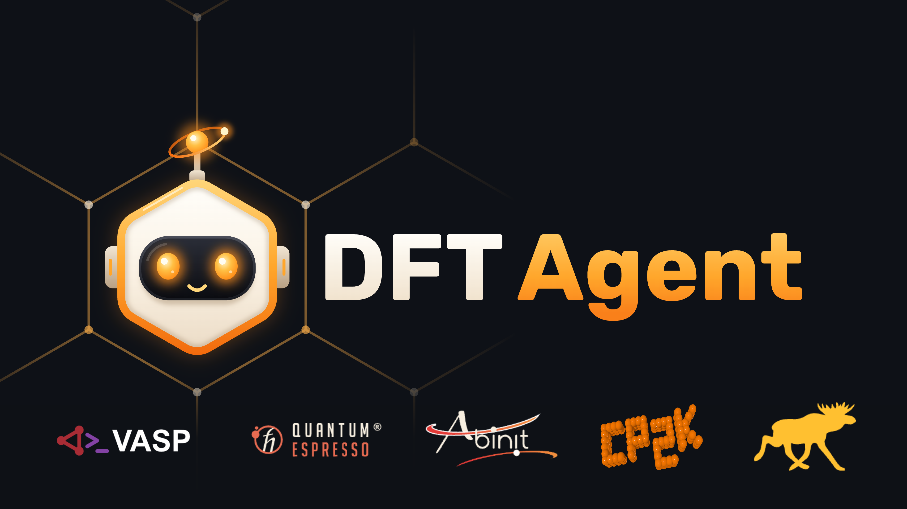
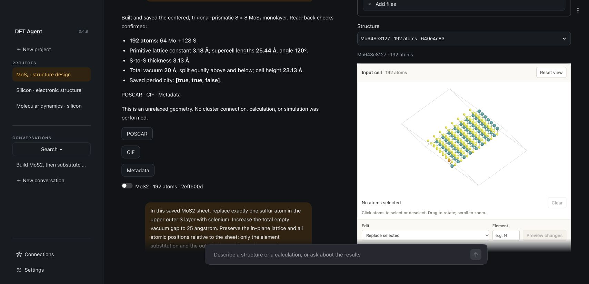
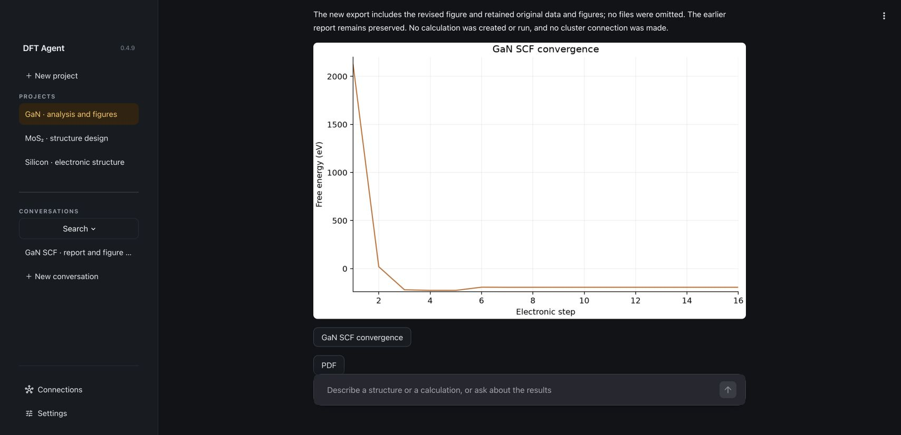
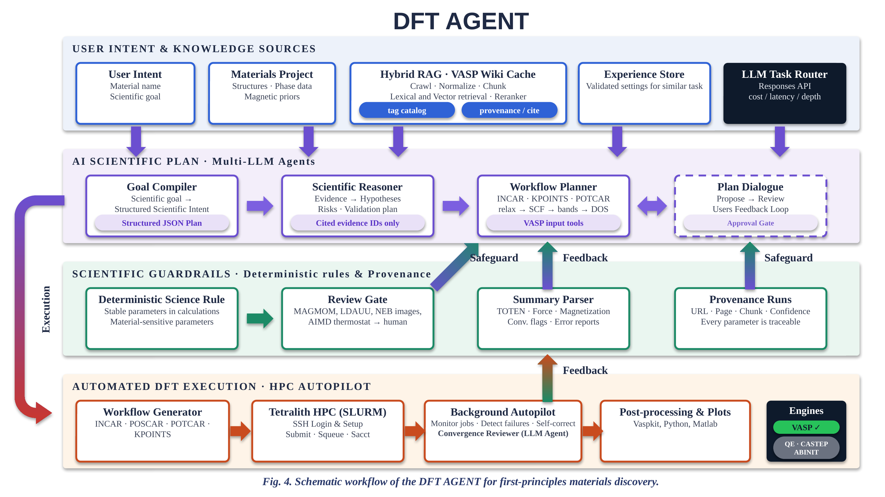

# DFT AGENT

**[Download for Mac](https://github.com/cuiqirui99/DFT-AGENT/releases/download/v0.4.9/DFT-Agent-0.4.9-macOS-arm64.dmg)** · v0.4.9 · [Getting started](docs/quickstart.md) · [Zenodo](https://doi.org/10.5281/zenodo.23867341) · [中文](README.zh-CN.md)

Build materials, run calculations and explore the results in conversation. DFT Agent connects your AI account to your computing cluster, with structures, tasks and results kept together in a project.

VASP · Quantum ESPRESSO · ABINIT · CP2K · Elk · SIESTA

[Qirui Cui](https://www.kth.se/profile/qiruic?l=en), KTH Royal Institute of Technology. With contributions from [Anna Delin](https://www.kth.se/profile/annadel).

## Work in a project

Keep a separate workspace for each study. Return to an earlier conversation, revise a task, inspect its files, or start another calculation from the same structure. A workflow can use different methods and engines at different stages.

*A 192-atom MoS₂ sheet, built in conversation and edited with a Se substitution.*

## Build and edit materials

Upload a CIF or POSCAR, find a published structure, or build one in chat. Create crystals, surfaces, interfaces, nanoribbons, magnetic junctions, layered and twisted structures, MOFs and COFs.

Change elements, remove atoms, enlarge the cell, apply strain or adjust layer spacing. Inspect atoms and bonds in 3D, keep earlier versions, and use the saved structure directly in a calculation.

[Structure tools](docs/structures.md) · [Point defects](docs/defects.md)

## From jobs to results

Refine calculation parameters and cluster resources in the conversation. Review the prepared inputs, confirm submission, and follow the job. Continue from compatible completed stages or supported MD checkpoints while keeping earlier runs.

Ask about the results, compare runs, change a plot, or request a report. Download retained engine outputs, CSV/JSON tables, HTML reports and PNG/PDF/SVG figures from the project.

*A completed GaN calculation: inspect the results, revise a plot and export a report.*

## Calculations

| Area | Workflows |
| --- | --- |
| Electronic structure | Relaxation, SCF, bands, DOS, magnetism, SOC, DFT+U and hybrid functionals. |
| Defects | Vacancies, substitutions and interstitials; charge states, defect levels and supported charged-cell corrections. |
| Lattice and superconductivity | Phonons, NEB, electron–phonon coupling and conventional superconductivity. |
| Molecular dynamics | First-principles MD, selected LAMMPS potentials, trajectories, thermodynamic data, RDF and MSD. |

Available methods depend on the engine. [VASP and methods](docs/methods.md) · [Quantum ESPRESSO](docs/qe.md) · [ABINIT, CP2K and Elk](docs/open-source-codes.md) · [SIESTA](docs/siesta.md) · [Molecular dynamics](docs/molecular-dynamics.md)

## Start here

For **Apple Silicon Macs with macOS 14 or later**. Open the download, drag **DFT Agent** to Applications, and launch it. Python and the scientific libraries are included. Create your first project, then:

1. **Connect AI.** Sign in with Codex CLI or Claude Code CLI, or enter an API key in **Connections → Model**. [Accounts and tokens](docs/models.md).
2. **Connect your cluster.** Enter its SSH address and follow the password or verification-code prompts. Use installed software or review an installation plan for a supported open-source engine. [Cluster setup](docs/install.md#your-first-cluster-setup).
3. **Start a calculation.** Upload or build a structure, describe the calculation, and refine the plan. Review its inputs and resources before submitting.

Model calls use your own account and quota; calculations use your cluster allocation. VASP requires your licensed installation and potentials. Codex CLI and Claude Code CLI can use project tools across several steps; API connections work one step at a time.

[Installation help](docs/install.md) · [Project guide](docs/project-workspace.md) · [Scientific guidance](docs/harness.md) · [Memory](docs/memory.md) · [Report an issue](https://github.com/cuiqirui99/DFT-AGENT/issues)

Workflow

Free for personal, academic and commercial use. This release distributes the application without its source tree. [License](LICENSE) · [Previous versions](https://github.com/cuiqirui99/DFT-AGENT/releases).

## Citation

Cui, Q. (2026). *DFT Agent* (Version 0.4.9). Zenodo. [doi:10.5281/zenodo.23867341](https://doi.org/10.5281/zenodo.23867341).

[Release notes](CHANGELOG.md) · [Notices](NOTICE.md)
