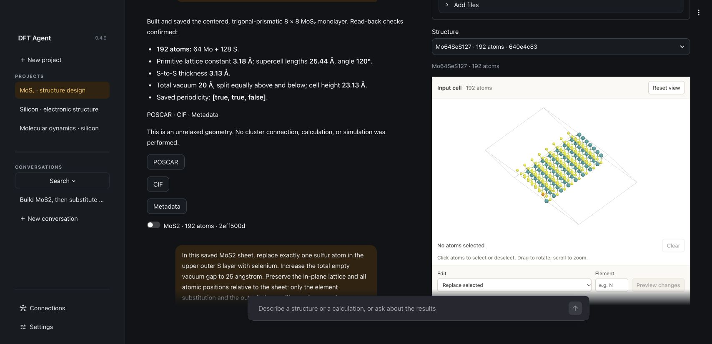
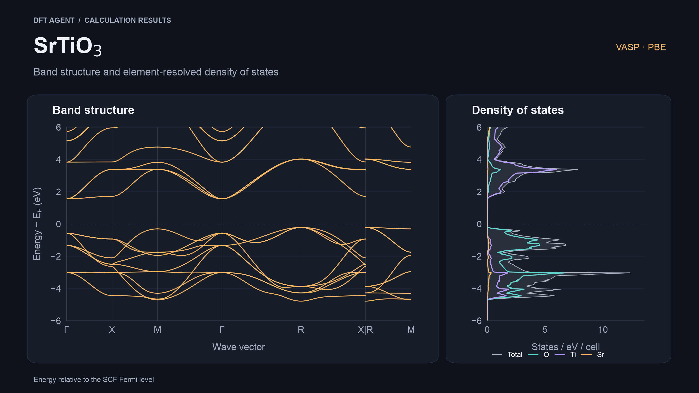
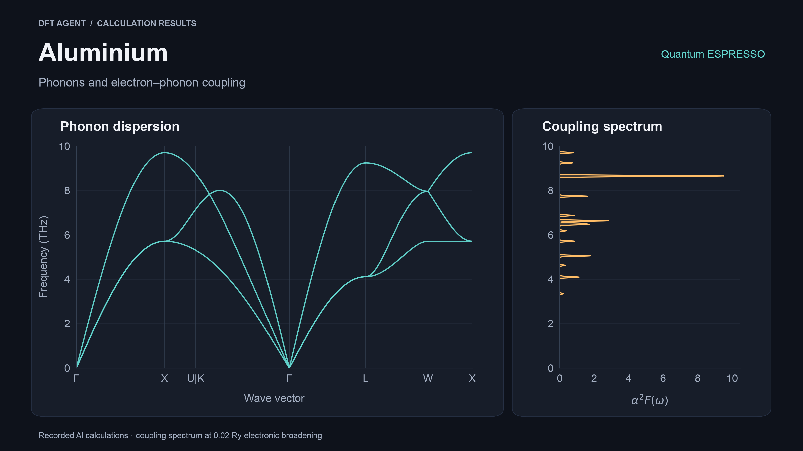

# DFT AGENT

**[下载 Mac 版](https://github.com/cuiqirui99/DFT-AGENT/releases/download/v0.5.0/DFT-Agent-0.5.0-macOS-arm64.dmg)** · v0.5.0 · [快速上手](docs/quickstart.md) · [Zenodo](https://doi.org/10.5281/zenodo.24116923) · [English](README.md)

通过对话构建材料、运行计算、分析结果。DFT Agent 连接你自己的 AI 账户和超算集群，将结构、任务和结果保存在同一个项目里。

VASP · Quantum ESPRESSO · ABINIT · CP2K · Elk · SIESTA · LAMMPS · RSPt · UppASD

作者：[Qirui Cui](https://www.kth.se/profile/qiruic?l=en)，KTH Royal Institute of Technology。贡献者：[Anna Delin](https://www.kth.se/profile/annadel)。

## 在项目里持续工作

为每项研究建立独立工作空间。随时回到之前的对话，修改任务、查看文件，或基于同一结构继续计算。一个工作流的不同阶段可以使用不同的方法和计算引擎。

*通过对话构建 192 原子的 MoS₂ 薄层，再将一个 S 原子替换为 Se。*

## 构建和修改材料

上传 CIF 或 POSCAR、检索已发表的结构，或直接在对话中建模。支持晶体、表面、界面、纳米带、磁性结、层状与扭转结构，以及 MOF、COF。

替换元素、移除原子、扩大晶胞、施加应变或调整层间距。在三维球棍视图中检查结构，保留此前版本，再将保存的结构直接用于计算。

[结构工具](docs/structures.md) · [点缺陷](docs/defects.md)

## 从提交任务到分析结果

在对话中调整计算参数和集群资源，检查输入后确认提交，随后跟踪任务。从兼容的已完成阶段或受支持的 MD 检查点继续，保留原有运行记录。

继续提问、比较运行结果、修改图表或生成报告。项目中可下载保留的引擎原始输出、CSV/JSON 数据表、HTML 报告，以及 PNG/PDF/SVG 图片。

*SrTiO₃：VASP 实算的能带与分元素态密度。*

*铝：Quantum ESPRESSO 实算的声子色散与电子–声子耦合谱。*

## 计算能力

| 方向 | 工作流 |
| --- | --- |
| 电子结构 | 结构优化、SCF、能带、DOS、磁性、SOC、DFT+U 和杂化泛函。 |
| 缺陷 | 空位、替位与间隙原子；电荷态、缺陷能级和受支持的带电晶胞修正。 |
| 晶格与超导 | 声子、NEB、电子–声子耦合和常规超导。 |
| 分子动力学 | 第一性原理 MD、部分 LAMMPS 势函数、轨迹、热力学数据、RDF 和 MSD。 |
| 磁性 | 用你已有的 RSPt 安装做 SCF、能带、DOS、交换张量和各向异性；UppASD 自旋动力学、Monte Carlo 采样和磁振子谱。 |

具体方法取决于所用引擎。[VASP 与计算方法](docs/methods.md) · [Quantum ESPRESSO](docs/qe.md) · [ABINIT、CP2K 和 Elk](docs/open-source-codes.md) · [SIESTA](docs/siesta.md) · [分子动力学](docs/molecular-dynamics.md) · [RSPt](docs/rspt.md) · [UppASD](docs/uppasd.md)

## 开始使用

适用于 **macOS 14 及以上的 Apple Silicon Mac**。打开下载的 `.dmg`，将 **DFT Agent** 拖到 Applications，再启动应用。已包含 Python 和科学计算依赖。先创建第一个项目，然后：

1. **连接 AI。** 在 **连接 → 模型**（英文界面为 Connections → Model）登录 Codex CLI 或 Claude Code CLI，也可以输入 API key。[账户与 tokens](docs/models.md)。
2. **连接超算。** 输入 SSH 地址，按提示输入密码或验证码。登录后应用以只读方式探测集群，由已连接的模型根据探测结果判断调度器和软件，再提交小测试作业验证 VASP、Quantum ESPRESSO、ABINIT、CP2K、Elk、SIESTA、LAMMPS 和 UppASD，并在登录节点上检查 Python、Wannier90 和 RSPt；缺少的开源程序会先问你是否安装。[集群配置](docs/install.md#your-first-cluster-setup)。
3. **开始计算。** 上传或构建结构，描述计算任务并完善方案。检查输入和资源配置后提交。

模型调用使用你自己的账户额度，计算使用你自己的集群配额。VASP 需要授权程序和赝势。Codex CLI 和 Claude Code CLI 可连续调用项目工具完成多个步骤；API 连接一次处理一个步骤。

[安装帮助](docs/install.md) · [项目指南](docs/quickstart.md) · [科学指导](docs/harness.md) · [经验库](docs/memory.md) · [反馈问题](https://github.com/cuiqirui99/DFT-AGENT/issues)

工作流程

个人、科研和商业工作均可免费使用。本次发布应用安装包，不公开应用源码。[许可证](LICENSE) · [历史版本](https://github.com/cuiqirui99/DFT-AGENT/releases)。

## 引用

Cui, Q. (2026). *DFT Agent* (Version 0.5.0). Zenodo. [doi:10.5281/zenodo.24116923](https://doi.org/10.5281/zenodo.24116923)。

[更新记录](CHANGELOG.md) · [第三方说明](NOTICE.md)
