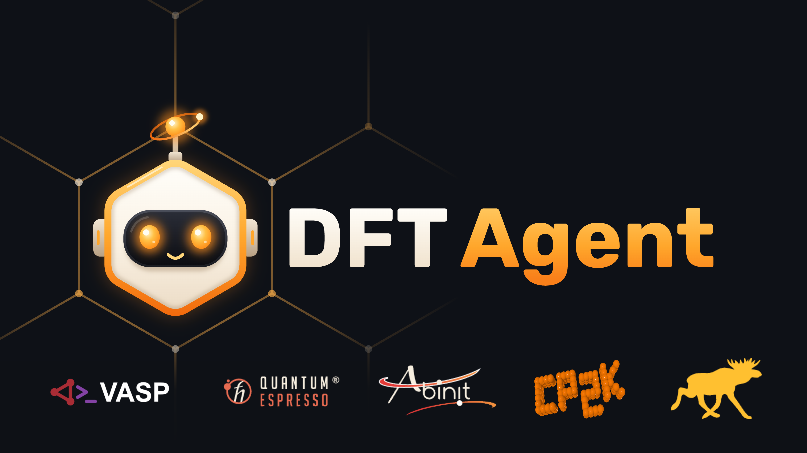
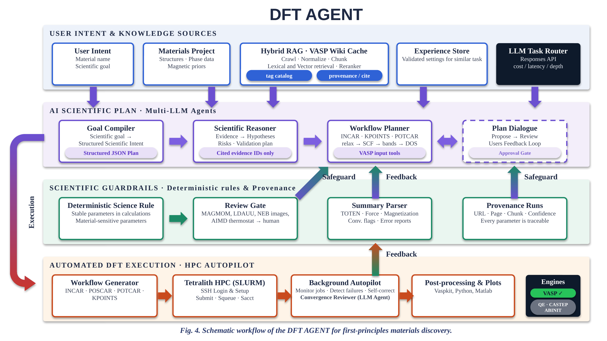
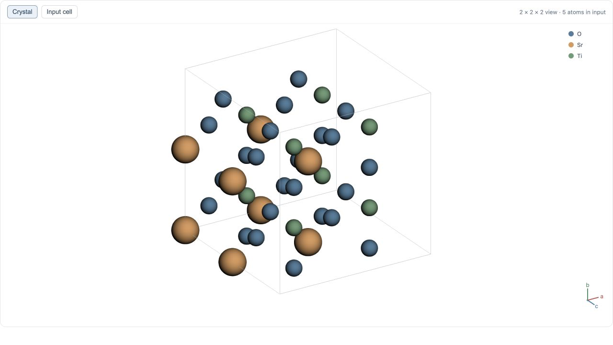

# DFT AGENT

版本 **0.4.9** · [下载 Mac 版](https://github.com/cuiqirui99/DFT-AGENT/releases/download/v0.4.9/DFT-Agent-0.4.9-macOS-arm64.dmg) · [English](README.md)

在同一个项目里建结构、安排计算、讨论结果。DFT Agent 连接你自己的 AI 账户和超算集群，保存每次对话、计算输入、结果和报告。

VASP · Quantum ESPRESSO · ABINIT · CP2K · Elk · SIESTA

作者：[Qirui Cui](https://www.kth.se/profile/qiruic?l=en)，KTH Royal Institute of Technology。贡献者：[Anna Delin](https://www.kth.se/profile/annadel)。

## 安装

本次提供 **macOS 14 及以上的 Apple Silicon 安装包**。打开下载的 `.dmg`，将 **DFT Agent** 拖到 Applications，再启动应用。已包含 Python 和科学计算依赖。[安装说明](docs/install.md)。

个人、科研和商业工作均可免费使用。本次发布应用安装包，不公开完整项目源码；旧版本及其原有许可证保持不变。[许可证](LICENSE) · [历史版本](https://github.com/cuiqirui99/DFT-AGENT/releases)。

## 使用

1. **连接 AI。** 在 **Connections → Model** 登录 Codex CLI 或 Claude Code CLI，也可以配置 API key。[账户与 tokens](docs/models.md)。
2. **连接超算。** 输入 SSH 地址，按提示输入密码或验证码，再检查软件和计算资源配置。[集群配置](docs/install.md#your-first-cluster-setup)。
3. **准备结构。** 上传 CIF/POSCAR、搜索材料，或用自然语言描述要构建的结构。检查并修改后再计算。[结构工具](docs/structures.md)。
4. **通过对话安排计算。** 可以继续修改结构、参数和资源。准备输入后，检查并确认提交。
5. **分析结果。** 继续提问、画图、导出数据与报告，或从已完成的阶段准备后续计算。

模型使用你自己的账户额度，计算使用你自己的集群配额。VASP 需要授权程序和赝势；开源计算程序可以通过应用部署到兼容集群。

## 功能

支持结构优化、电子结构、磁性、SOC、DFT+U 和杂化泛函等计算，具体方法取决于所用引擎。

- [复杂结构](docs/structures.md)：界面、纳米带、层状与扭转结构、结和框架材料。
- [缺陷](docs/defects.md)：点缺陷、电荷态和电子能级。
- [分子动力学](docs/molecular-dynamics.md)：第一性原理 MD、部分 LAMMPS 势函数、轨迹分析和受支持的续算。
- [Quantum ESPRESSO](docs/qe.md)：声子、NEB 和[电子–声子耦合](docs/qe-superconductivity.md)。
- [SIESTA](docs/siesta.md) 及 [ABINIT、CP2K、Elk](docs/open-source-codes.md)。

[项目使用指南](docs/project-workspace.md) · [科学指导](docs/harness.md) · [经验库](docs/memory.md) · [反馈问题](https://github.com/cuiqirui99/DFT-AGENT/issues)

## 引用

Cui, Q. (2026). *DFT Agent* (Version 0.4.9). Zenodo. [doi:10.5281/zenodo.23867341](https://doi.org/10.5281/zenodo.23867341)。

[更新记录](CHANGELOG.md) · [第三方说明](NOTICE.md)
